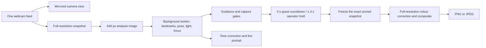

# Rough implementation — Misrah live photobooth

Live pipeline implemented in v0.2; frontal test scenes and independent synthetic guests added in v0.3 on 19 October 2026.

## Guest kiosk — v0.5

The guest route starts on a dedicated **Touch to start** screen. Six template cards commit a choice and open the camera while a bundled four-second lights clip plays. Capture is gated until the clip finishes. The guest camera then uses the existing quality policy with a three-second continuous hold, a visible 3–2–1 countdown and automatic capture of the exact scored frame. Failed quality checks reset the countdown. A ready-frame manual shutter remains available.

`guest-flow.js` coordinates welcome, choice, lights, camera, processing and review. A navigation token cancels pending video/camera transitions; `LiveCamera` still owns track cleanup and stale inference epochs. Camera closure/cancellation returns to the template screen. Opening failures and stopped live checks expose Try camera again. Processing opens a separate modal until the shared image pipeline completes.

The result offers Print my photo, Retake (same template), Choose another template, Save a copy, and Finish (welcome). Clearing a guest invalidates source/tone work, stops streams, clears photo state and the print image. A two-minute idle timeout warns for the final 20 seconds; processing and printing suspend it.

Printing decodes a full-resolution JPEG copy of the finished canvas before calling `window.print()`. Print CSS hides all UI and fits the image without cropping onto a 4 × 6 inch page with zero CSS margin. The browser/system dialog handles printer choice. `afterprint` reports only that the dialog closed: it cannot distinguish a submitted job from cancellation or verify physical output. No printer bridge or physical lighting control is implemented.

The bundled MP4 is silent H.264, 1280 × 720, 30 fps, four seconds, authored and verified with HyperFrames. It is seek/reset on every capture attempt. Video playback failure has a bounded fallback to the camera; reduced motion uses a short static hold. Its source lives outside the standalone app in `../videos/photobooth-lights/`.

`studio.html` retains the operator controls using the shared local worker and compositing pipeline. The existing synthetic fixtures and labelled sample URLs remain available for internal verification.

## Deployment target

Apple-silicon Mac mini, 24 GB RAM, Chrome or Edge, USB webcam and soft frontal lighting. Python 3 serves the bundled app on loopback. There are no cloud APIs, accounts, runtime CDN requests, external processing services, or photo uploads.

24 GB is a reasonable memory configuration for this design. RAM capacity alone does not establish the frame rate: benchmark the exact chip, camera resolution, browser and attached displays. The current prototype uses CPU WebAssembly; it does not automatically use Apple's Neural Engine or Core ML.

## Processing paths

One camera stream is enough. Native video remains separate from the paced analysis loop. A worker performs the synchronous model inference and pixel operations. Only one live analysis job can be in flight: new frames are skipped rather than added to a backlog. This keeps latency bounded when the machine slows down.

- Camera request: 1280 × 960, up to 30 fps, video only. The webcam/browser may negotiate a different size or rate.
- Analysis: longest side at most 640 px; default 10 checks/sec, adjustable to 5 or 15.
- Live portrait: 480 px wide, refreshed after each successful analysis result.
- Final image: selected frame's native size, 1024 × 1536 for the two frontal test scenes, 1441 × 2161 for the three original client scenes.
- Automatic capture freezes the same full-resolution snapshot used to make the analysis image; it does not grab a later, unscored video frame.

## Preparing a template

Two new frontal heritage scenes and three separate frontal guest headshots are bundled as synthetic test fixtures. The scenes use near-horizontal eye lines, symmetric frontal lighting and a near-frontal head pose to reduce the perspective difference with a guest looking into the camera. Exact Image Generation prompts are in `qa/frontal-generation-prompts.json`. The simulated camera defaults to an independent guest portrait, not the target scene's own face.

The three client artwork pages are copied into local assets. On startup the worker detects each original face. The app prepares a landmark contour mask, eye-based alignment, original scene colour statistics and a centred face sample. A second inference on that standardised sample gives a more comparable target head angle than the original off-centre face in the full artwork. Manual mask refinement remains necessary before final event approval.

## Live guidance and capture

The worker uses MediaPipe VIDEO mode with two-face detection and facial transformation matrices. The UI checks the unsmoothed observations. Display smoothing affects the preview only.

Starting thresholds, intended to be tuned on the actual event camera:

| Check | Starting policy |
| --- | --- |
| Guest count | Exactly one detected face; two faces block auto capture |
| Framing | Whole face in view; useful face size and central placement |
| Head pose | Within about 16° yaw, 17° pitch and 18° roll of template pose |
| Exposure | Face luminance approximately 42–224 / 255, with clipped/dark-pixel limits |
| Uneven light | Left/right face brightness difference at most 65 / 255 |
| Sharpness | Laplacian variance at least 16 on a fixed 112 × 112 face crop |
| Movement | Eye position and face-size change below starting thresholds |
| Continuous hold | 3 seconds for guests / 1.4 seconds in operator studio, at least five passing observations; a failed check or gap over 750 ms resets the hold |

Brightness, clipping, shadow balance and sharpness are heuristics, not a trained assessment of photographic quality. Pose is approximate, particularly across different camera fields of view. Occlusions, closed eyes and glasses are not explicitly classified in this version. Manual capture remains available when the operator chooses to override the gates.

## Colour and light correction

The face crop provides luminance and colour statistics. Exposure adjustment is limited to 0.8–1.28×, channel white-balance gains to 0.9–1.1×, with a small shadow lift. Original client scenes use a reference sepia chromaticity treatment (strength 0.85); generated frontal scenes use a weaker treatment (0.35) that retains the source luminance structure. It does not force the guest's face to the reference person's brightness or reconstruct a different light direction. Manual warmth and brightness controls remain available; automatic correction is reversible from the retained original photo.

The preview corrects its small analysis image in the worker. After capture, the original-resolution source is corrected in the same worker and composited with the calibrated mask. This avoids installing a second Python image pipeline before it is needed. If event testing reveals edge problems that require Poisson blending, a local OpenCV service can be added for final stills while keeping live guidance on the existing worker.

## Lifecycle and privacy

Camera close, Escape, capture, camera switch and a hidden page stop the camera tracks and invalidate pending callbacks. Closing resets the hold and preview. Start fresh clears the guest photo and returns to the default frontal weaver scene. No guest history is persisted. Explicit downloads remain in the chosen download folder. This is application cleanup, not a promise of forensic memory erasure.

## Event readiness

Before promising performance, run a sustained session on the chosen Mac mini with its actual webcam and monitor. Validate the three face masks against a varied set of consenting guest portraits, tune framing and quality thresholds, and check lighting and autofocus. Native kiosk packaging, silent hardware printing and neural pose/relighting are separate work items.

Relevant primary documentation: [MediaPipe Face Landmarker Web](https://developers.google.com/edge/mediapipe/solutions/vision/face_landmarker/web_js), [OpenCV regional blending](https://docs.opencv.org/4.x/df/da0/group__photo__clone.html).
